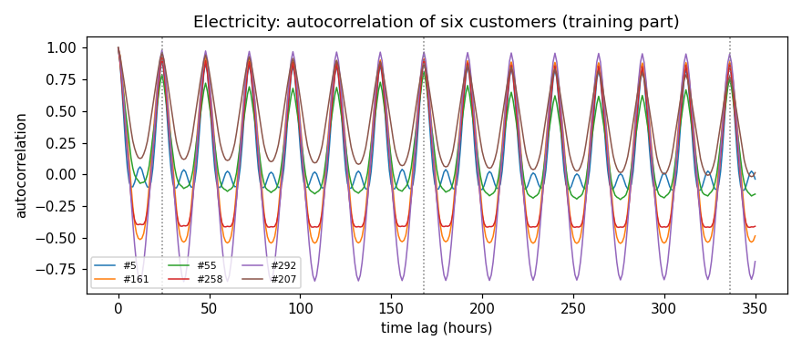
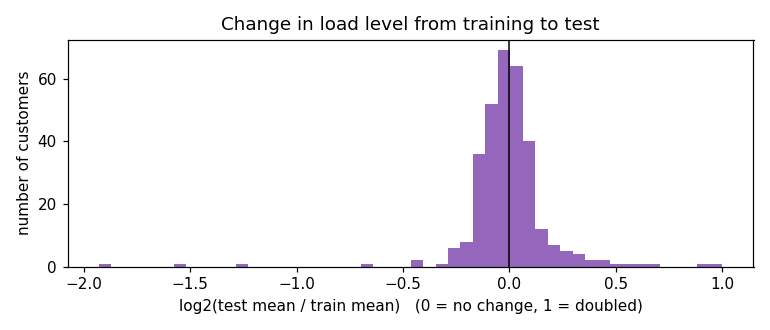
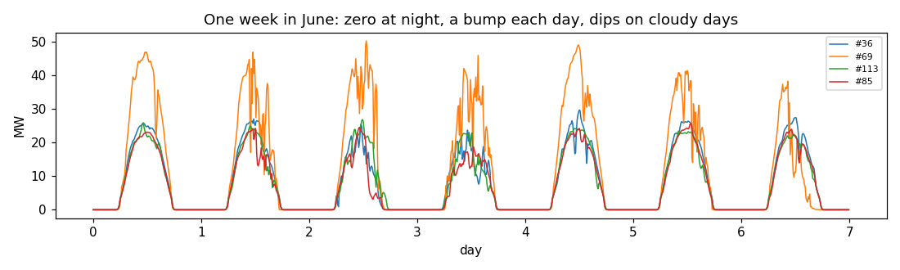
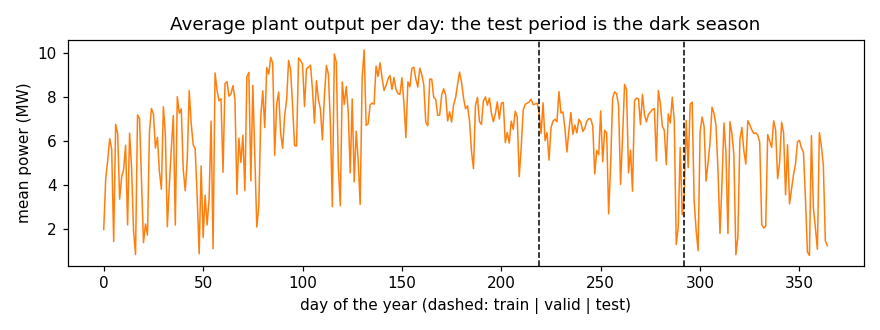

# Reproducing LSTNet on Electricity and Solar-Energy, and testing whether the deep part earns its complexity

**Deep Learning · M.Sc. Applied Data Science and AI · SRH University Munich · Winter semester 2026/27**
**Author(s):** Chandana Gurusiddappa (Electricity), Dineshkumar Swaminathan (Solar-Energy) · **Repository:** https://github.com/Chandana18G/lstnet-reproduction · **Date:** [hand-in date]

---

## Abstract

[Four or five sentences: the task, the paper, the data, your reproduced result next to the published one, your improvement and its measured effect (mean ± spread).]

## 1 · The paper and the task (research understanding, part of 15 %)

- **Paper:** Guokun Lai, Wei-Cheng Chang, Yiming Yang, Hanxiao Liu. *Modeling Long- and
  Short-Term Temporal Patterns with Deep Neural Networks.* SIGIR 2018 (41st International ACM
  SIGIR Conference on Research and Development in Information Retrieval), Ann Arbor, USA.
  https://doi.org/10.1145/3209978.3210006 · free full text: https://arxiv.org/abs/1703.07015 ·
  authors' code: https://github.com/laiguokun/LSTNet
- **Task:** multivariate time-series forecasting. The input is the last q = 168 time steps of all
  n series at once (an n × 168 table); the output is the value of all n series at **one** future
  time step, h = 24 steps after the last input step (regression, not a sequence of 24 values).
  - *Electricity* (Chandana): 168 hours of electricity use of 321 customers → the use of all 321
    customers 24 hours later.
  - *Solar-Energy* (Dinesh): 168 ten-minute steps (28 hours) of power output of 137 PV plants →
    the output of all 137 plants 24 steps (4 hours) later.
- **Their method in our own words (LSTNet):** real series such as electricity use repeat
  themselves every day and every week (long-term pattern), but also depend on the last few hours
  (short-term pattern). LSTNet combines five parts:
  1. **Convolution:** 100 filters, each 6 time steps long and as wide as *all* series, slide
     along time and pick up short local patterns across all series at once (ReLU, no pooling).
  2. **GRU (recurrent network):** reads the convolution output step by step and keeps a memory;
     its last hidden state summarises the whole window.
  3. **Skip-GRU:** a second GRU that only looks at every p-th step (p = 24 for hourly data), i.e.
     the same hour on consecutive days. This lets it learn the daily pattern directly instead of
     remembering it over 24 steps.
  4. **Dense layer:** combines the GRU and skip-GRU states into one prediction per series.
  5. **Autoregressive (AR) "highway":** a plain linear model on the last 24 values of each series
     (the same weights for every series), added to the neural prediction. The paper argues that
     the neural part alone does not react to changes in scale, and the linear part does
     (Sec. 4.6).

  Training (Sec. 3.7–3.8 and the authors' code): absolute (L1) or squared loss, chosen on the
  validation set; Adam optimiser; dropout 0.2; the model with the best validation error is
  kept. Data are split 60 % / 20 % / 20 % in time order (Sec. 4.3). Hyperparameters were tuned by
  grid search on the validation set (Sec. 4.4); the authors' run scripts give the final values.
  They report two variants (LSTNet-Skip and LSTNet-Attn); we reproduce **LSTNet-Skip**.
- **Their main result:** LSTNet beats all baselines on the three datasets with repeating
  patterns, by up to 22 % RSE over a plain GRU at horizon 24 (Sec. 4.5). We reproduce one column
  of **Table 2** (page 101): **horizon 24**, LSTNet-Skip, plus the AR baseline from the same table.
  Metrics (Sec. 4.2): RSE, root relative squared error (lower is better), and CORR, the
  correlation between prediction and truth averaged over series (higher is better).

  | Dataset (horizon 24) | LSTNet-Skip RSE | LSTNet-Skip CORR | AR RSE | AR CORR |
  |---|---|---|---|---|
  | Electricity | 0.1007 | 0.9119 | 0.1054 | 0.8595 |
  | Solar-Energy | 0.4643 | 0.8870 | 0.8699 | 0.5314 |

  *Source: Lai et al. 2018, Table 2.*

## 2 · The data (start this week)

### Electricity (Chandana)

| | |
|---|---|
| Source and version | Authors' repository `laiguokun/multivariate-time-series-data`, file `electricity/electricity.txt.gz` (last commit 7f402f1, 09.04.2017), downloaded 18.10.2026 with `scripts/download_data.sh`. Raw data: UCI *ElectricityLoadDiagrams20112014*; the authors removed 2011, kept 321 clients and converted to hourly values (their README; paper Sec. 4.3). |
| Licence | The authors' data repository has **no licence file**, so we name the original source: UCI *ElectricityLoadDiagrams20112014*, licence **CC BY 4.0** (use, share and adapt, also commercially, with attribution). The authors' code (github.com/laiguokun/LSTNet), which we read for the settings, is under the **MIT licence**. |
| Size | 26,304 hourly time steps (2012–2014) × 321 customers, no missing values. One sample = 168 hours × 321 customers (input) → 321 values (target). |
| Classes or targets | Regression, no classes: the target is the consumption (kWh) of every customer 24 hours after the input window. Instead of class balance: customer means range from 11 to 200,529 kWh (factor ~19,000); 1.1 % of values are 0; customer #182 is 0 for the whole test period (left out of CORR). Strong daily and weekly cycle (median autocorrelation 0.94 at 24 h, 0.91 at 168 h). |
| Splits | By time, 60 / 20 / 20 as in the paper: training hours 0–15,781 (~15,600 samples), validation 15,782–21,042 (5,261), test 21,043–26,303 (5,261). Why: forecasting predicts the future from the past; neighbouring hours are almost identical, so a random split would leak information; and it is the paper's split, so the numbers are comparable. |
| Preprocessing | No cleaning needed. Each customer is divided by its largest absolute value (the authors' `normalize=2`); predictions are multiplied back to kWh for the metrics. As in the authors' code, this maximum is taken over the whole series, not over the training set only (see leakage checks). |
| Leakage checks | Split strictly by time; a test checks that the newest input step is exactly 24 h before the target and that no target is in two splits. Scaling on all data: 53 of 321 customers reach their maximum in the test period, but the median ratio of whole-series to training-only maximum is 1.00; we keep the authors' scaling for comparability and name it as a limitation. Best epoch and AR lag order are chosen on validation; the test set is used once. No duplicates: each hour appears once. |
| Shared with Biomedical Image Analysis? | No. |

*Figure 1. Electricity: autocorrelation of six customers (training part); peaks every 24 hours and at one week.*

*Figure 2. Electricity: change of each customer's mean from training to test (log2 ratio, 0 = no change). Median 0.99; 24 customers change by more than 20 %.*

### Solar-Energy (Dinesh)

| | |
|---|---|
| Source and version | Authors' repository `laiguokun/multivariate-time-series-data`, file `solar-energy/solar_AL.txt.gz` (last commit 7f402f1, 09.04.2017), downloaded 22.10.2026 with `scripts/download_data.sh`. Raw data: NREL *Solar Power Data for Integration Studies*, PV plants in Alabama, 2006 (paper Sec. 4.3). |
| Licence | NREL publishes the data openly for research. The authors' copy has no licence file of its own; we cite NREL and the authors. [Dinesh: confirm the exact terms on the NREL page.] |
| Size | 52,560 time steps (every 10 minutes, one year) × 137 plants, no missing values. One sample = 168 steps (28 hours) × 137 plants (input) → 137 values (target). |
| Classes or targets | Regression, no classes: the target is the output (MW) of every plant 24 steps (4 hours) after the input window. Instead of class balance: plant means range from 1.6 to 19.1 MW (factor ~12); 55.1 % of all values are 0 (night; at 49.5 % of steps all plants are 0); no constant plant. Strong daily cycle (median autocorrelation 0.85 at 144 steps = one day), weak at the horizon (0.32 at 24 steps). |
| Splits | By time, 60 / 20 / 20 as in the paper: training days 0–219 (January to early August, ~31,300 samples), validation days 219–292 (10,512), test days 292–365 (late October to December, 10,512). Why: as for Electricity; in addition, the split is a season split, and only a split by time shows whether the model handles a season it has not seen. |
| Preprocessing | No cleaning; night zeros are kept, as in the paper. Each plant is divided by its largest absolute value (the authors' scaling); predictions are multiplied back for the metrics. |
| Leakage checks | Split strictly by time (same tests as above). Scaling on all data: no plant reaches its maximum in the test period, median ratio of whole-series to training-only maximum 1.00, so the scaling leaks nothing here. Choices on validation only; test used once. No duplicates. Note the shift: every plant produces less in the test period (median test/train ratio 0.71). |
| Shared with Biomedical Image Analysis? | No. |

*Figure 3. Solar-Energy: one week of output of example plants: zero at night, one peak per day.*

*Figure 4. Solar-Energy: every plant produces less in the test period (winter); median ratio 0.71.*

## 3 · Reproducing the baseline (part of 15 %, and 25 % implementation)

**The recipe**, read from the paper and the authors' code (github.com/laiguokun/LSTNet: `main.py`,
`models/LSTNet.py`, `utils.py` and the run scripts `ele.sh`, `solar.sh`). Our implementation:
`src/data.py`, `src/model.py`, `src/train.py`.

| | The paper says | Where (page, table, code) | What we use |
|---|---|---|---|
| Data: version, split | Electricity: 321 clients, hourly, 2012–2014. Solar-Energy: 137 PV plants, 10 min, 2006. Split 60 / 20 / 20 in chronological order. | Sec. 4.3 (p. 99), Table 1 (p. 100); `utils.py` | The authors' published files (section 2); the same 60 / 20 / 20 split by time, decided by the target time step. |
| Model: layers, sizes, pretrained? | LSTNet-Skip: convolution → GRU + skip-GRU → dense, plus a linear AR component. Sizes chosen by grid search: window q from 2⁰…2⁹, CNN/GRU hidden {50, 100, 200}, skip-GRU hidden {20, 50, 100}, skip p = 24 (Electricity), tuned 2…64 (Solar). Not pretrained. CNN filter width, AR window: **not stated**. | Sec. 3.2–3.6 (p. 97–98), Sec. 4.4 (p. 100) | The authors' run scripts: window 168, CNN 100 filters of width 6, GRU 100, skip 24, skip-GRU 5 (Electricity) / 10 (Solar), AR window 24, dropout 0.2, no output activation. 325,871 parameters for Electricity. A test shows our forward pass equals the authors' code (`tests/test_model.py`). Not pretrained. |
| Training: optimiser, learning rate, schedule | Adam. Learning rate and schedule **not stated**. Dropout 0.1 or 0.2. Loss: L1 or squared, chosen on validation. | Sec. 3.7–3.8 (p. 98–99), Sec. 4.4 (p. 100); code: `main.py` | Adam, learning rate 0.001, no schedule, gradient clipping to norm 10, dropout 0.2, L1 loss (the code's default) **summed and computed in original units** (prediction × scale vs target × scale), as in `main.py`. |
| Training: epochs, batch size | **Not stated.** | code: `main.py` defaults | 100 epochs, batch size 128; we keep the weights of the epoch with the best validation RSE (as `main.py`). |
| Augmentation and preprocessing | No augmentation. Normalisation **not stated** in the paper. | code: `utils.py` (`normalize=2`) | No augmentation. Each series divided by its maximum absolute value over the whole series (as the code); see section 2 for the leak this causes and its size. |
| Metric, and how it was averaged | RSE: squared error pooled over all series and test steps, relative to the spread of the test targets. CORR: Pearson correlation per series, averaged over series. | Sec. 4.2, Eq. 10–11 (p. 99); code: `evaluate()` in `main.py` | The same, in original units (`src/metrics.py`). Series with zero variance in the test targets are left out of CORR, as in the code (Electricity: 1 customer; Solar: none). |

- **Setup:** Python and PyTorch (laptop: Python 3.14, PyTorch 2.12 on CPU; Colab: [PyTorch version] on an NVIDIA T4 GPU), NumPy, SciPy. Electricity, horizon 24, uses the settings of the authors' `ele.sh`; Solar uses `solar.sh` but with horizon 24 (see below). 10 seeds per model (0–9); same seed = same initial weights and batch order.
- **What the paper did not say,** and what we chose instead:
  - learning rate, epochs, batch size, gradient clipping, CNN filter width, AR window, normalisation → the authors' code defaults (0.001, 100, 128, 10, 6, 24, divide by maximum);
  - the final hyperparameters of the grid search → the authors' run scripts; we do **not** repeat the grid search;
  - how many runs the reported number is based on → not stated (probably one run); we report mean ± standard deviation over 10 seeds;
  - the training loss is summed in original units in the code (not mentioned in the paper) → we do the same.
- **Where paper and code disagree:**
  - the paper uses ReLU in the GRU's candidate state (Sec. 3.3, p. 98); the code uses the standard GRU (tanh) → we follow the code;
  - skip sequence length (q − ω) / p = 6.75 in the code (float) → we use the whole number 6 (the last 144 CNN steps);
  - `solar.sh` does not set the horizon, so it runs at horizon 12, but Table 2 reports horizon 24 → we use 24;
  - the paper's grid includes an AR regularisation coefficient {0.1, 1, 10}; the code has none → no regularisation.

| Test set, horizon 24 | Paper (Table 2) | Ours (mean ± std, 10 seeds) |
|---|---|---|
| Electricity, RSE | 0.1007 | **0.1008 ± 0.0018** |
| Electricity, CORR | 0.9119 | 0.9070 ± 0.0062 |
| Solar-Energy, RSE | 0.4643 | **0.4753 ± 0.0249** |
| Solar-Energy, CORR | 0.8870 | 0.8835 ± 0.0098 |

**Electricity: reproduced.** Our mean test RSE over 10 seeds (0.1008) is within 0.0001 of the
paper's 0.1007, well inside one standard deviation (0.0018). CORR is 0.0049 lower than published
(0.9070 vs 0.9119); the paper's number lies within one standard deviation of ours (0.0062). The
remaining small CORR gap can come from details we could not match exactly: the paper reports
one run (seed and number of runs not stated), the code uses tanh in the GRU where the paper
writes ReLU, and the skip length is rounded (6 instead of 6.75 steps). Results:
`results/stats_electricity_h24.md`; training: `notebooks/03_train_on_colab.ipynb`.

**Checks of our AR baseline (Electricity)** (professor's feedback; `src/check_ar.py`,
`results/ar_checks_electricity.md`). Our AR (one linear model per customer, least squares) reaches
test RSE 0.0981, the paper's AR 0.1054. We checked four possible reasons:

1. *RSE as in Eq. 10:* our formula and the authors' code formula give the same value on the same
   predictions (0.098090 both): original units, pooled over all customers and test hours,
   divided by the spread of the whole test set.
2. *Off-by-one in the horizon:* a unit test checks that the newest input is exactly h steps before
   the target. Our AR is better than the paper's at **every** horizon (h = 3: 0.0818 vs 0.0995;
   h = 6: 0.0913 vs 0.1035; h = 12: 0.0957 vs 0.1050; h = 24: 0.0981 vs 0.1054), so the gap is
   not a shifted horizon.
3. *Scaling on the training part only:* gives exactly the same test RSE (0.098090); a least-squares
   fit per customer does not change when the customer is multiplied by a constant.
4. *The window:* this explains the gap. With short windows (L = 1 to 16 hours) our AR reaches test
   RSE 0.1035–0.1042 at horizon 24, within 1–2 % of the paper's 0.1054. Only windows of 128 hours
   or more, which see the same hour on several previous days, bring it down to 0.098. We choose
   L on validation from the paper's grid 1 … 512 (L = 256); the paper does not report which window
   its AR used.

So the gap is explained by the window length, not by a bug: a well-tuned linear model with a long
window is stronger than the AR baseline in the paper.

**Solar-Energy: reproduced.** Our mean test RSE over 10 seeds (0.4753) is 2 % above the paper's
0.4643, within half a standard deviation (0.0249); CORR is almost the same (0.8835 vs 0.8870). The
spread over seeds is much larger than on Electricity (std 0.0249 vs 0.0018), so a single run, as in
the paper, can land anywhere between about 0.45 and 0.50. Settings: the authors' `solar.sh`
(skip-GRU size 10) at horizon 24. Results: `results/stats_solar_h24.md`.

## 4 · Your improvement (20 %)

### Electricity (Chandana): LSTNet + RevIN

- **Idea:** add reversible instance normalisation (RevIN; Kim et al., ICLR 2022) to LSTNet-Skip.
  Before the network, each customer's input window is shifted to mean 0 and scaled to standard
  deviation 1, using only that window; after the network, the prediction is moved back to the
  window's own mean and scale. Two learnable numbers per customer (scale and shift) are added.
  Everything else (data, split, settings, training) stays the same as in the reproduction.
- **Why it should help:** the paper itself names the weakness: the neural part of LSTNet "is
  not sensitive to the scale of inputs" when the level of a series changes, which is why it adds
  the linear AR part (Sec. 3.6, Sec. 4.6, Fig. 6). RevIN removes the level directly, so the
  network only has to learn the shape of the daily and weekly pattern. Our data show such level
  changes: between training and test, 24 of 321 customers change their mean load by more than
  20 %, 8 by more than 50 %, and one drops to zero (section 2, Figure 2).
- **Expected effect:** **Because** the level of some customers drifts between training and test
  (Figure 2), **we expect** RevIN **to improve** the test RSE of LSTNet-Skip at horizon 24
  **by about** 1–3 % (for example from about 0.101 to about 0.099), measured as the mean over
  10 seeds. Because the median customer keeps its level (test/train ratio 0.99), we expect only
  a small gain, and CORR to stay about the same.
- **Comparisons (not improvements):** our AR baseline (one linear model per customer) and
  DLinear (Zeng et al., AAAI 2023), a strong simple linear model, trained with the same budget.
  "LSTNet without AR" is the paper's own ablation (LSTw/oAR, Fig. 5) and counts as reproduction.

### Solar-Energy (Dinesh)

- **Idea:** the same change as on Electricity: RevIN around LSTNet-Skip, with everything else
  unchanged, so the two datasets can be compared directly.
- **Why it should help:** Solar has a strong level shift: because the split by time is also a
  split by season, **every** plant produces less in the winter test period (median test/train
  ratio 0.71, range 0.62–0.83; section 2, Figure 4). Removing each window's level is exactly what
  RevIN is designed for.
- **Expected effect:** **Because** every plant's output level drops by about 29 % from the
  training (spring/summer) to the test (early winter) period, **we expect** RevIN **to improve** the
  test RSE of LSTNet-Skip at horizon 24, more than on Electricity, where the level hardly changes.
  [Dinesh: check this sentence and add the size of the expected gain as you wrote it before the
  runs.]
- **Next idea (planned):** a one-day skip (p = 144 steps) with a 3-day window (432 steps); the
  paper only tried skips of 2–64 for Solar, which cannot see the daily cycle (median
  autocorrelation 0.85 at 144 steps).

## 5 · Experiments (part of 20 % and 15 %)

- **Design:** one change at a time; the same data splits, the same budget; at least three seeds per setting.

**Electricity, horizon 24, test set** (each neural model: 10 seeds, the same splits, settings and
budget of 100 epochs; the best epoch is chosen on validation):

| Setting | Test RSE mean | ± spread (std) | Test CORR mean ± std | seeds |
|---|---|---|---|---|
| baseline: LSTNet-Skip (reproduction) | 0.1008 | 0.0018 | 0.9070 ± 0.0062 | 10 |
| + RevIN (our improvement) | 0.1060 | 0.0014 | 0.9172 ± 0.0010 | 10 |
| − AR component (paper's ablation LSTw/oAR) | 0.1476 | 0.0096 | 0.8617 ± 0.0043 | 10 |
| DLinear (comparison) | 0.1035 | 0.0003 | 0.9052 ± 0.0003 | 10 |
| AR, one model per customer (comparison, least squares) | 0.0981 | – (deterministic) | 0.9231 | – |
| *Paper: LSTNet-Skip* | *0.1007* | – | *0.9119* | – |

- **Statistical comparison** (`src/stats.py`; Holm-corrected over the four comparisons with LSTNet):
  - *Over seeds:* paired t-test and Wilcoxon signed-rank test, seed k against seed k (same seed =
    same initial weights and batch order).
  - *Over test hours:* Diebold–Mariano test on the squared error per hour (summed over customers),
    using the forecast averaged over the 10 seeds; Newey–West variance with lag h − 1 = 23 and the
    Harvey–Leybourne–Newbold correction.

  | Model vs LSTNet | Mean RSE difference | Paired t-test p (Holm) | Wilcoxon p (raw) | DM statistic | DM p (Holm) |
  |---|---|---|---|---|---|
  | + RevIN | +0.0052 (worse) | 0.0001 | 0.0020 | +1.39 | 0.33 |
  | − AR component | +0.0468 (worse) | < 0.0001 | 0.0020 | +9.37 | < 0.0001 |
  | DLinear | +0.0027 (worse) | 0.0017 | 0.0059 | +1.85 | 0.19 |
  | AR (one model per customer) | −0.0027 (better) | – (no seeds) | – | −0.88 | 0.38 |

  **What this shows for Electricity:**
  - **Our hypothesis is not confirmed.** RevIN makes RSE **worse** by 5 % (0.1060 vs 0.1008),
    consistently over all 10 seeds (paired t-test p = 0.0001). It improves CORR (0.9172 vs
    0.9070) and makes the runs more stable (std 0.0010 vs 0.0062). Over the test hours, the
    difference is not significant (DM p = 0.33). Our reading: RevIN gets the *shape* of the
    daily pattern better (CORR), but rescaling each window loses information about the absolute
    level, which RSE in kWh punishes, especially for the largest customers.
  - **The AR component matters most**, as the paper claims (Sec. 4.6, Fig. 5): without it RSE
    rises by 46 % (0.1476), significant in every test.
  - **The deep part does not clearly earn its complexity on Electricity:** the linear AR model
    (0.0981) is slightly better than LSTNet (0.1008), and DLinear slightly worse (0.1035), but
    neither difference is significant over the test hours (DM p = 0.38 and 0.19).

**Solar-Energy, horizon 24, test set** (the same design; skip-GRU size 10 as in `solar.sh`):

| Setting | Test RSE mean | ± spread (std) | Test CORR mean ± std | seeds |
|---|---|---|---|---|
| baseline: LSTNet-Skip (reproduction) | 0.4753 | 0.0249 | 0.8835 ± 0.0098 | 10 |
| + RevIN (improvement) | 0.5055 | 0.0137 | 0.8578 ± 0.0060 | 10 |
| − AR component (paper's ablation LSTw/oAR) | 0.4529 | 0.0104 | 0.8922 ± 0.0051 | 10 |
| DLinear (comparison) | 0.5740 | 0.0011 | 0.8167 ± 0.0009 | 10 |
| AR, one model per plant (comparison, least squares, L = 512) | 0.5247 | – (deterministic) | 0.8462 | – |
| *Paper: LSTNet-Skip* | *0.4643* | – | *0.8870* | – |

  | Model vs LSTNet (Solar) | Mean RSE difference | Paired t-test p (Holm) | Wilcoxon p (raw) | DM statistic | DM p (Holm) |
  |---|---|---|---|---|---|
  | + RevIN | +0.0302 (worse) | 0.041 | 0.027 | +2.12 | 0.034 |
  | − AR component | −0.0224 (better) | 0.022 | 0.006 | −2.49 | 0.026 |
  | DLinear | +0.0987 (worse) | < 0.0001 | 0.002 | +4.70 | < 0.0001 |
  | AR (one model per plant) | +0.0494 (worse) | – (no seeds) | – | +5.81 | < 0.0001 |

  **What this shows for Solar:**
  - **The hypothesis is not confirmed here either:** RevIN makes RSE 6 % worse (0.5055 vs 0.4753)
    and also lowers CORR (0.8578 vs 0.8835); the RSE difference is significant in both tests, although Solar has the
    strong level shift RevIN is designed for. A possible reason, still to be checked: many input
    windows are mostly night zeros, and normalising such near-constant windows is unstable.
  - **Unlike the paper's ablation, LSTNet without its AR part is slightly better on Solar**
    (−0.0224, p = 0.02 in both tests). Not yet analysed; possible reasons are the night zeros and
    the change of season, which make a fixed linear rule on the last 4 hours misleading.
  - **Here the deep part does earn its complexity:** LSTNet clearly beats both linear models
    (AR 0.5247, DLinear 0.5740; DM p < 0.0001).

**Both datasets together:** the answer to our question depends on the data. On Electricity
(regular daily and weekly cycles) linear models are as good as LSTNet and LSTNet's own AR part
does most of the work; on Solar (night zeros, weather, season change) the neural network clearly
wins and the AR part is not needed. RevIN did not improve RSE on either dataset.
- **Test set:** used **once**, for the final models only.

## 6 · Evaluation and error analysis (15 %)

- [Metrics that fit the task (not only accuracy): confusion matrix, precision, recall, F1, IoU, …]
- [Where does the model fail? Examples of its most confident mistakes; which classes are confused, and why]
- [Limitations: what your results do **not** show]

## 7 · Conclusion

We reproduced LSTNet-Skip at horizon 24 on both datasets with the authors' settings and 10 seeds:
RSE 0.1008 ± 0.0018 on Electricity (paper 0.1007) and 0.4753 ± 0.0249 on Solar-Energy (paper
0.4643). Our question was whether LSTNet's deep part earns its complexity over simple linear
models, and the answer depends on the data. On Electricity it does not: a linear model with one
set of weights per customer and a long window (RSE 0.0981) is as good as LSTNet, and LSTNet loses
46 % of its accuracy without its own linear AR part. On Solar it does: LSTNet clearly beats both
linear models (AR 0.5247, DLinear 0.5740), and the AR part is not even needed. Our improvement,
RevIN, did not lower RSE on either dataset (Electricity +5 %, Solar +6 %), although it improved
CORR and stability on Electricity. Next we would analyse where RevIN's extra error comes from
(section 6), give LSTNet's AR part a longer, per-series window on Electricity, and try a one-day
skip (144 steps) on Solar.

## 8 · Use of AI tools (5 %)

[Which tools you used, for what (code, text, debugging), and how you **checked** their output. Be specific.]

## 9 · Reproducibility (part of 25 %)

- **Run it:** [the commands or notebook order; the environment, for example `requirements.txt`]
- **Seeds and hardware:** [seeds used; GPU or CPU; training time]
- **Where the results come from:** [which notebook/script makes which table and figure]

## References

[All papers, data sets, code and websites you used.]
